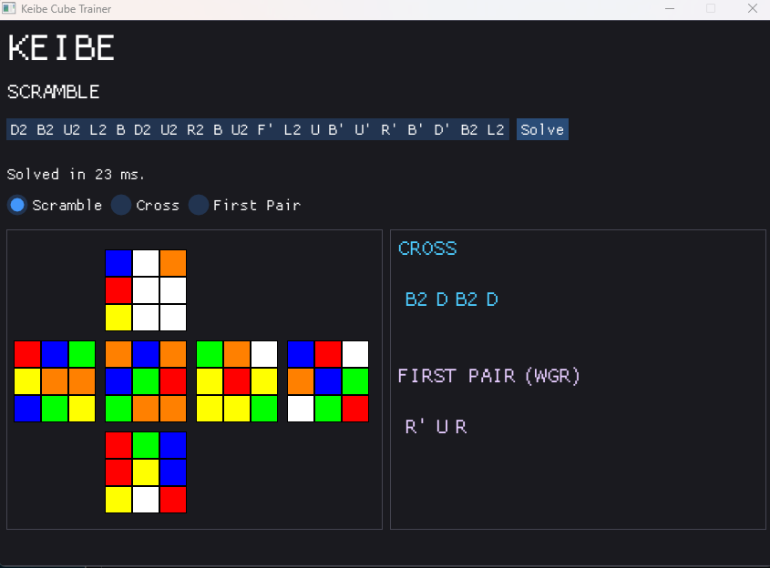

# Keibe — Rubik's Cube Cross & First Pair Solver

Keibe is a C++ Rubik's Cube solving tool designed around the first two stages of CFOP: solving the **cross** and the **first F2L pair**.

It combines cube-state simulation, search algorithms, and a graphical interface to generate solutions from a scramble, helping CFOP solvers explore ways to approach the beginning of a solve with better efficiency.

## Screenshot

## Features

- **Cross solving** — generates a solution for the white cross.
- **First-pair solving** — finds a solution for the first F2L pair after the cross.
- **Interactive cube visualisation** — view the scramble, cross, and first-pair states.
- **Scramble input and validation** — enter a scramble and check that the input is valid before solving.
- **Solution timing** — displays the time taken to generate a solution.
- **Native desktop GUI** — built with C++, Dear ImGui, GLFW, and OpenGL.

## Supported Notation & Limitations

### Move notation

Keibe supports standard face turns:

- **Clockwise turns:** R, L, U, D, F, B

- **Inverse turns:** R', L', U', D', F', B'

- **Double turns:** R2, L2, U2, D2, F2, B2

The following move types are not currently supported in scramble input:

- **Cube rotations:** x, y, z

- **Wide turns:** Rw, Uw, etc.

- **Slice turns:** M, E, S

- **Triple turns:** R3, U3 etc.

### Fixed cross orientation

Keibe currently solves the cross using a fixed orientation:

- **Cross colour:** White

- **Front face:** Green

The solver assumes that scrambles are done with white on top and green at the front, then automatically rotates to solve cross plus one with white cross and green front (yellow on top). The solver does not currently allow the user to choose a different cross colour or front-face orientation.

## How It Works

Keibe represents the Rubik's Cube as a collection of 54 stickers and simulates cube moves to explore possible states.

Search algorithms and heuristics are used to find solutions for the cross and first F2L pair. The first-pair solver also explores short, human-friendly move sequences to find efficient ways to complete a pair.

The goal is to bridge the gap between computational search and the practical way CFOP solvers approach a solve.

## Getting Started

### Download

Download the latest Windows release from the [GitHub Releases](../../releases) page.

1. Download `Keibe-v1.0.0.zip`.
2. Extract the ZIP file.
3. Run `Keibe.exe`.

Keep the executable and its accompanying DLL files together in the extracted folder.

### Usage

1. Enter a valid Rubik's Cube scramble.
2. Start the solver.
3. Switch between the scramble, cross, and first-pair views to inspect the resulting cube states and solutions.

## Built With

- **C++** — cube representation, move simulation, and solving logic.
- **Dear ImGui** — graphical user interface.
- **GLFW** — window and input management.
- **OpenGL** — rendering.
- **CMake** — build configuration.
- **vcpkg** — dependency management.

## Project Background

Started as an exploration of cube-state representation and heuristic search in C++. It grew into a standalone desktop application, with an emphasis on finding useful solutions for human CFOP solving rather than simply producing arbitrary move sequences.

## Future Ideas

- More detailed solution playback and analysis.
- Finger trick, look-ahead and general execution advice.
- Additional F2L techniques and solving stages.
- Further improvements to search efficiency and solution quality.
